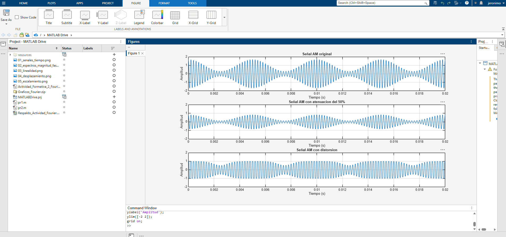
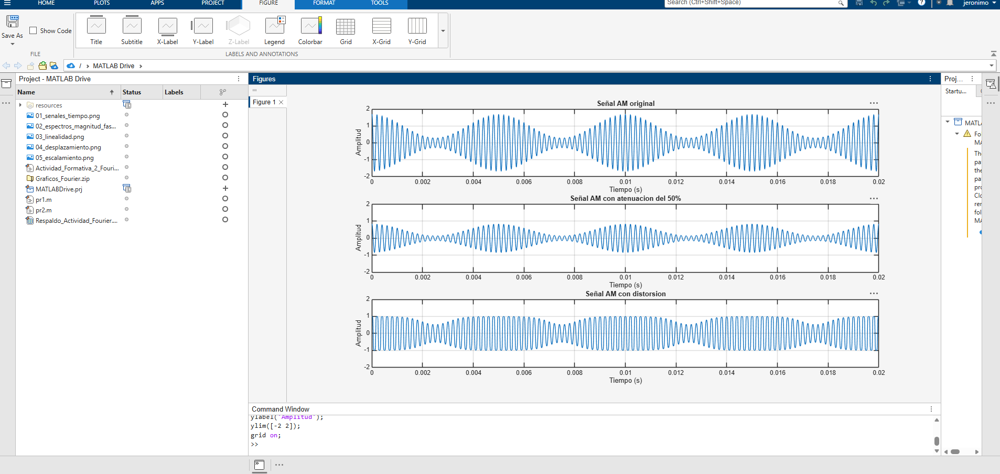
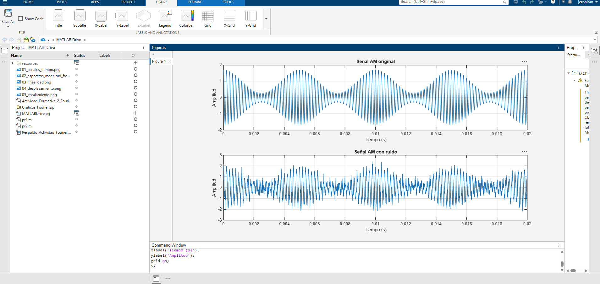
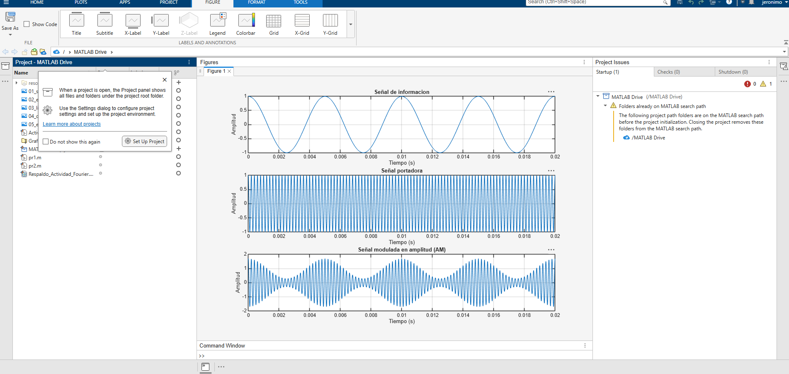

## Datos académicos

**Alumno:** Jerónimo Bautista Torres  
**Docente:** Ing. Luis Osvaldo Moreno Gaytán  
**Asignatura:** Señales y Sistemas  
**Actividad:** Formativa 4 – Implementación y análisis de un sistema de modulación en amplitud (AM)  
**Herramienta:** MATLAB
# Actividad Formativa 4 – Modulación en amplitud (AM)

## Evidencias de MATLAB

### 1. Atenuación y distorsión

### 2. Comparación de atenuación y distorsión

### 3. Señal AM con ruido

### 4. Espectro de frecuencias FFT

### 5. Señal de información, portadora y AM

## Código fuente
El archivo `Actividad4_Modulacion_AM.m` contiene el programa desarrollado en MATLAB.
## Presentación del proyecto

La presentación contiene el desarrollo de la Actividad Formativa 4, los conceptos de modulación AM, las gráficas obtenidas en MATLAB y el análisis de resultados.

**Ver presentación en Canva:**

https://canva.link/0y5u5p78qpby2qg
