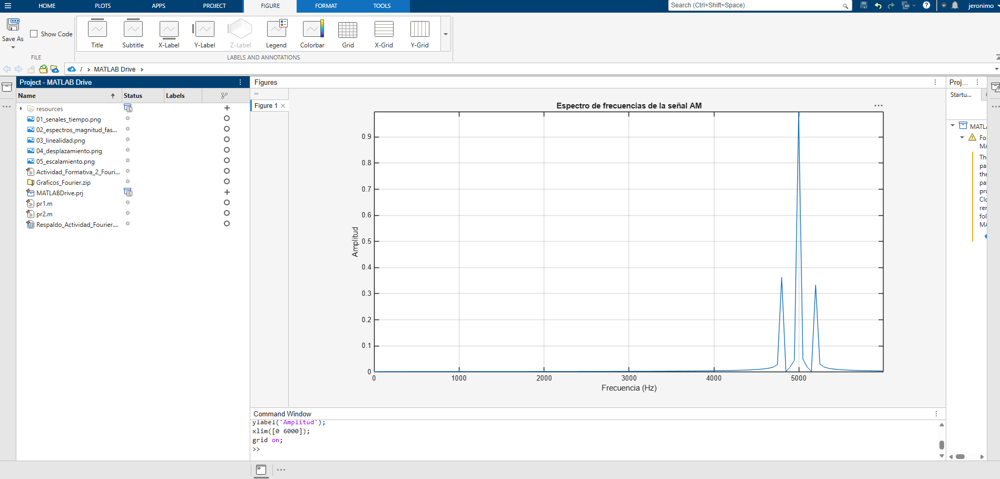

# Actividad Formativa 4 – Modulación en amplitud (AM)

## Evidencias de MATLAB

### 1. Atenuación y distorsión

### 2. Comparación de atenuación y distorsión

### 3. Señal AM con ruido

### 4. Espectro de frecuencias FFT

### 5. Señal de información, portadora y AM

## Código fuente
El archivo `Actividad4_Modulacion_AM.m` contiene el programa desarrollado en MATLAB.
